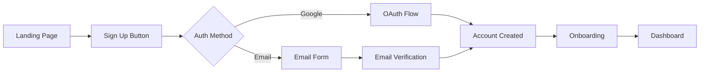
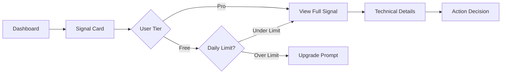

# Frontend Specification - CryptoSuccess Platform

## 1. Design System

### 1.1 Brand Identity
- **Primary Color**: #0052FF (Electric Blue - Trust & Technology)
- **Secondary Color**: #00D964 (Success Green - Profit & Growth)
- **Accent Color**: #FFB800 (Alert Gold - Warnings & Premium)
- **Error Color**: #FF3B30 (Signal Red - Losses & Errors)
- **Background**: #0A0B0D (Dark Mode Default)
- **Surface**: #1A1B1F (Card Backgrounds)
- **Text Primary**: #FFFFFF
- **Text Secondary**: #A0A3BD

### 1.2 Typography
```css
/* Headings - Inter */
--font-heading: 'Inter', -apple-system, BlinkMacSystemFont, sans-serif;

/* Body Text - Inter */
--font-body: 'Inter', -apple-system, BlinkMacSystemFont, sans-serif;

/* Monospace - JetBrains Mono */
--font-mono: 'JetBrains Mono', 'Consolas', monospace;

/* Type Scale */
--text-xs: 0.75rem;    /* 12px */
--text-sm: 0.875rem;   /* 14px */
--text-base: 1rem;     /* 16px */
--text-lg: 1.125rem;   /* 18px */
--text-xl: 1.25rem;    /* 20px */
--text-2xl: 1.5rem;    /* 24px */
--text-3xl: 1.875rem;  /* 30px */
--text-4xl: 2.25rem;   /* 36px */
```

### 1.3 Spacing System
```css
/* 8px Grid System */
--space-1: 0.5rem;   /* 8px */
--space-2: 1rem;     /* 16px */
--space-3: 1.5rem;   /* 24px */
--space-4: 2rem;     /* 32px */
--space-5: 2.5rem;   /* 40px */
--space-6: 3rem;     /* 48px */
--space-8: 4rem;     /* 64px */
--space-10: 5rem;    /* 80px */
```

## 2. Component Library

### 2.1 Navigation Component
```tsx
// Navigation Bar
<nav className="fixed top-0 w-full bg-surface/95 backdrop-blur-md z-50 border-b border-gray-800">
  <div className="container mx-auto px-4">
    <div className="flex items-center justify-between h-16">
      {/* Logo */}
      <div className="flex items-center space-x-2">
        <CryptoSuccessLogo className="w-8 h-8" />
        <span className="text-xl font-bold">CryptoSuccess</span>
      </div>

      {/* Navigation Items */}
      <div className="hidden md:flex items-center space-x-6">
        <NavLink to="/dashboard" label="Dashboard" />
        <NavLink to="/signals" label="Signals" />
        <NavLink to="/pricing" label="Pricing" />
      </div>

      {/* User Menu */}
      <UserMenu />
    </div>
  </div>
</nav>
```

### 2.2 Signal Card Component
```tsx
// Signal Display Card
<div className="bg-surface rounded-xl p-6 border border-gray-800 hover:border-primary transition-colors">
  <div className="flex items-start justify-between mb-4">
    <div className="flex items-center space-x-3">
      <CoinIcon coin="ETH" className="w-10 h-10" />
      <div>
        <h3 className="text-lg font-semibold">Ethereum</h3>
        <p className="text-sm text-gray-400">ETH/USDT</p>
      </div>
    </div>
    <SignalBadge action="BUY" confidence={85} />
  </div>

  <div className="grid grid-cols-2 gap-4 mb-4">
    <div>
      <p className="text-sm text-gray-400">Current Price</p>
      <p className="text-xl font-mono">${price}</p>
    </div>
    <div>
      <p className="text-sm text-gray-400">24h Change</p>
      <p className={`text-xl font-mono ${change > 0 ? 'text-green-500' : 'text-red-500'}`}>
        {change > 0 ? '+' : ''}{change}%
      </p>
    </div>
  </div>

  <TechnicalIndicators data={indicators} />
</div>
```

### 2.3 Chart Component
```tsx
// Price Chart with Signals
<div className="bg-surface rounded-xl p-6">
  <div className="flex items-center justify-between mb-6">
    <h2 className="text-xl font-semibold">Price Chart</h2>
    <TimeframeSelector
      options={['1H', '4H', '1D', '1W']}
      selected={timeframe}
      onChange={setTimeframe}
    />
  </div>

  <div className="h-96">
    <ResponsiveContainer width="100%" height="100%">
      <LineChart data={chartData}>
        <XAxis dataKey="time" />
        <YAxis />
        <Tooltip content={<CustomTooltip />} />
        <Line
          type="monotone"
          dataKey="price"
          stroke="#0052FF"
          strokeWidth={2}
          dot={false}
        />
        {/* Signal Markers */}
        {signals.map(signal => (
          <ReferenceLine
            key={signal.id}
            x={signal.timestamp}
            stroke={signal.action === 'BUY' ? '#00D964' : '#FF3B30'}
          />
        ))}
      </LineChart>
    </ResponsiveContainer>
  </div>
</div>
```

## 3. Page Layouts

### 3.1 Landing Page
```
┌─────────────────────────────────────────────────────────┐
│ Navigation Bar                                          │
├─────────────────────────────────────────────────────────┤
│                                                         │
│             Hero Section (Full Height)                  │
│                                                         │
│    "AI-Powered Crypto Trading Signals"                 │
│     [Get Started] [View Demo]                          │
│                                                         │
├─────────────────────────────────────────────────────────┤
│                Features Grid                            │
│  ┌─────────┐  ┌─────────┐  ┌─────────┐  ┌─────────┐  │
│  │   AI    │  │  Real   │  │ Simple  │  │ Trusted │  │
│  │ Signals │  │  Time   │  │   UI    │  │   By    │  │
│  └─────────┘  └─────────┘  └─────────┘  └─────────┘  │
├─────────────────────────────────────────────────────────┤
│                  How It Works                           │
│    1. Connect    2. Analyze    3. Trade               │
├─────────────────────────────────────────────────────────┤
│                 Pricing Section                         │
│  ┌─────────────┐              ┌─────────────┐         │
│  │    Free     │              │     Pro      │         │
│  │  $0/month   │              │  $29/month   │         │
│  └─────────────┘              └─────────────┘         │
├─────────────────────────────────────────────────────────┤
│                    Footer                               │
└─────────────────────────────────────────────────────────┘
```

### 3.2 Dashboard Layout
```
┌─────────────────────────────────────────────────────────┐
│ Navigation Bar                                          │
├───────────┬─────────────────────────────────────────────┤
│           │                                             │
│  Sidebar  │            Main Content Area               │
│           │                                             │
│ Dashboard │  ┌─────────────────────────────────────┐   │
│ Signals   │  │       Portfolio Summary             │   │
│ Watchlist │  └─────────────────────────────────────┘   │
│ Account   │                                             │
│ Settings  │  ┌───────────────┐  ┌───────────────┐     │
│           │  │ Active Signal │  │ Active Signal │     │
│           │  └───────────────┘  └───────────────┘     │
│           │                                             │
│           │  ┌─────────────────────────────────────┐   │
│           │  │         Price Chart                 │   │
│           │  └─────────────────────────────────────┘   │
│           │                                             │
└───────────┴─────────────────────────────────────────────┘
```

### 3.3 Mobile Responsive Design
```
Mobile (< 768px)
┌─────────────────┐
│   Hamburger     │
│   Navigation    │
├─────────────────┤
│                 │
│ Stacked Cards   │
│                 │
├─────────────────┤
│ Chart (Swipeable│
│    Timeframes)  │
├─────────────────┤
│ Bottom Nav      │
└─────────────────┘
```

## 4. User Flows

### 4.1 Registration Flow


### 4.2 Signal Viewing Flow


## 5. Interactive Elements

### 5.1 Animations
```css
/* Smooth Transitions */
.signal-card {
  transition: all 0.3s cubic-bezier(0.4, 0, 0.2, 1);
}

/* Pulse Animation for New Signals */
@keyframes pulse {
  0% { box-shadow: 0 0 0 0 rgba(0, 217, 100, 0.4); }
  70% { box-shadow: 0 0 0 10px rgba(0, 217, 100, 0); }
  100% { box-shadow: 0 0 0 0 rgba(0, 217, 100, 0); }
}

.new-signal {
  animation: pulse 2s infinite;
}

/* Loading States */
.skeleton {
  background: linear-gradient(
    90deg,
    #1a1b1f 25%,
    #2a2b2f 50%,
    #1a1b1f 75%
  );
  background-size: 200% 100%;
  animation: loading 1.5s infinite;
}
```

### 5.2 Micro-interactions
- **Hover States**: Subtle elevation on cards
- **Click Feedback**: Ripple effect on buttons
- **Loading States**: Skeleton screens
- **Success States**: Green checkmark animations
- **Error States**: Shake animation with red highlight

## 6. Accessibility

### 6.1 WCAG 2.1 Compliance
```tsx
// Accessible Button Component
<button
  className="px-6 py-3 bg-primary text-white rounded-lg hover:bg-primary-dark focus:outline-none focus:ring-2 focus:ring-primary focus:ring-offset-2"
  aria-label="View trading signal for Ethereum"
  role="button"
  tabIndex={0}
>
  View Signal
</button>

// Screen Reader Announcements
<div className="sr-only" role="status" aria-live="polite">
  New buy signal for Ethereum with 85% confidence
</div>
```

### 6.2 Keyboard Navigation
- Tab order follows logical flow
- All interactive elements keyboard accessible
- Escape key closes modals
- Arrow keys navigate lists
- Enter/Space activate buttons

## 7. Performance Optimization

### 7.1 Image Optimization
```tsx
// Lazy Loading Images


// Responsive Images
<picture>
  <source srcSet="/hero-mobile.webp" media="(max-width: 768px)" />
  <source srcSet="/hero-desktop.webp" media="(min-width: 769px)" />
  
</picture>
```

### 7.2 Code Splitting
```tsx
// Route-based Code Splitting
const Dashboard = lazy(() => import('./pages/Dashboard'));
const Signals = lazy(() => import('./pages/Signals'));
const Account = lazy(() => import('./pages/Account'));

// Component-level Splitting
const ChartComponent = lazy(() => import('./components/ChartComponent'));
```

## 8. State Management

### 8.1 Global State Structure
```typescript
interface AppState {
  auth: {
    user: User | null;
    loading: boolean;
    error: string | null;
  };
  signals: {
    latest: Signal[];
    history: Signal[];
    loading: boolean;
    filter: SignalFilter;
  };
  market: {
    prices: Record<string, MarketData>;
    lastUpdate: number;
  };
  subscription: {
    plan: 'free' | 'pro';
    signalsUsedToday: number;
    billingCycle: Date | null;
  };
  ui: {
    theme: 'dark' | 'light';
    sidebarOpen: boolean;
    activeModal: string | null;
  };
}
```

### 8.2 Context Providers
```tsx
// Auth Context
<AuthProvider>
  <SubscriptionProvider>
    <MarketDataProvider>
      <SignalProvider>
        <App />
      </SignalProvider>
    </MarketDataProvider>
  </SubscriptionProvider>
</AuthProvider>
```

## 9. Error Handling

### 9.1 Error States
```tsx
// Error Boundary Component
<ErrorBoundary fallback={<ErrorFallback />}>
  <Dashboard />
</ErrorBoundary>

// Inline Error Display
{error && (
  <div className="bg-red-900/20 border border-red-500 rounded-lg p-4">
    <p className="text-red-500">{error.message}</p>
    <button onClick={retry} className="text-sm underline mt-2">
      Try Again
    </button>
  </div>
)}
```

### 9.2 Loading States
```tsx
// Skeleton Loading
{loading ? (
  <div className="space-y-4">
    {[1, 2, 3].map(i => (
      <div key={i} className="bg-surface rounded-xl p-6 animate-pulse">
        <div className="h-4 bg-gray-700 rounded w-3/4 mb-2" />
        <div className="h-4 bg-gray-700 rounded w-1/2" />
      </div>
    ))}
  </div>
) : (
  <SignalList signals={signals} />
)}
```

## 10. Responsive Breakpoints

### 10.1 Breakpoint System
```css
/* Tailwind Default Breakpoints */
--screen-sm: 640px;   /* Mobile landscape */
--screen-md: 768px;   /* Tablet portrait */
--screen-lg: 1024px;  /* Tablet landscape */
--screen-xl: 1280px;  /* Desktop */
--screen-2xl: 1536px; /* Large desktop */
```

### 10.2 Responsive Utilities
```tsx
// Responsive Grid
<div className="grid grid-cols-1 md:grid-cols-2 lg:grid-cols-3 gap-6">
  {signals.map(signal => (
    <SignalCard key={signal.id} {...signal} />
  ))}
</div>

// Responsive Text
<h1 className="text-2xl md:text-3xl lg:text-4xl font-bold">
  AI-Powered Trading Signals
</h1>

// Responsive Spacing
<div className="px-4 md:px-6 lg:px-8 py-6 md:py-8 lg:py-12">
  {/* Content */}
</div>
```

This frontend specification provides a comprehensive guide for implementing the CryptoSuccess platform's user interface with a focus on modern design, accessibility, and performance.